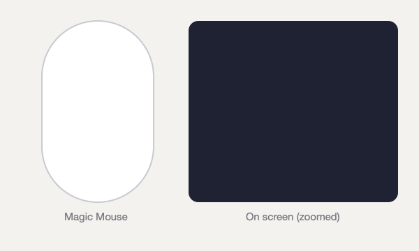

# Magic Flow

Draw letters with your fingertip on the top of an Apple Magic Mouse, and each letter runs an action: open an app, open a link or file, press a keyboard shortcut. Slide along the mouse's edges to change the volume, brightness, tabs, zoom and more. Out of the box, **F** opens Finder, **B** opens your browser, and the front edge is a volume slider.



*A real fingertip F recorded from the Magic Mouse's touch sensor and replayed. The right panel is zoomed. The strokes are real; the still hold before them is drawn in, because the recording predates hold-to-start.*

Magic Flow is a fork of [Jitouch](https://github.com/JitouchApp/Jitouch) (it was called Jitouch FingerDraw until November 2026). Jitouch already recognizes letters on the Magic Mouse, but you draw them by moving the whole mouse. Magic Flow reads your fingertip on the mouse's touch surface instead.

## What it adds to Jitouch

- **Fingertip drawing on the Magic Mouse surface.** Hold a finger still for half a second, then draw and lift.
- **Edge sliders.** Touch an edge of the mouse and slide along it. Each edge can be Volume, Brightness, Switch tabs, Zoom, Undo / redo or Switch desktops. Slide right (front and back edges) or forward (side edges) to go up. The front edge is Volume by default and the others are off. Side edges only count near the front, so a thumb resting lower down is ignored.
- **Magic Flow Settings,** a small app for your letters and edges: turn mouse letters on, map each letter to an action or a recorded keyboard shortcut, and pick a slider for each edge. Changes apply right away.
- **Tap to click.** A light one-finger tap is a left click; two quick taps double-click (at your system's double-click speed). A two-finger tap is a right click.
- **Drag with a fingertip.** Touch the top of the mouse and move the mouse right away, and whatever is under the pointer gets dragged until you lift. Or tap, touch again, and move. Slide the finger while dragging to scroll, for example to extend a text selection past the screen.
- **Every capital, A to Z,** in the usual one- or multi-stroke forms: F as a stem plus two bars, L, V or P with or without lifting, and so on. Draw I with its top and bottom bars, since a single straight line is a scroll. Your trained letters win close calls with the built-in shapes.
- **Learns your handwriting** (optional). Record each letter a few times, and recognition is matched to how you write.
- **Doesn't fire while you scroll or click.** A click and a scroll flick both start with a touch, so these are ignored: taps that click the button, touches during scrolling, single straight or back-and-forth strokes, and runs of parallel flicks.
- **Chrome ink on screen** in the mouse's real proportions: sterling silver rope with blackened grooves and a glint running along it. The pointer hides while you draw, so only the line shows.
- **A log** of every gesture, fired or ignored, with the reason: `~/Library/Logs/Jitouch-gestures.log`.

## How to draw

1. **Rest one finger** on the top of the mouse and keep it, and the mouse, still for about half a second. A dot appears.
2. **Draw** the letter without lifting. A finger left still for more than 1.5 s counts as resting, not drawing.
3. For letters with more than one stroke, **lift and keep going**. The letter is read half a second after your last stroke.

Single straight or back-and-forth strokes (up, down, left, right, diagonal) are ignored on the mouse, because they look exactly like scrolling.

## Install

### Build from source

Requirements: a Mac with Apple silicon, a Magic Mouse, and the Xcode Command Line Tools (`xcode-select --install`). Full Xcode isn't needed. Tested only on macOS 26.5.

```sh
git clone https://github.com/emartin-coder/magic-flow.git && cd magic-flow
./make-signing-identity.sh   # once: a local signing certificate, so rebuilds keep the Accessibility permission
./build.sh                   # downloads the official Jitouch 2.82.1 bundle, runs the tests, builds, installs
```

This installs `/Applications/Magic Flow.app` and `/Applications/Magic Flow Settings.app`, and adds Magic Flow to your login items. Then:

1. Allow **Magic Flow** under System Settings > Privacy & Security > Accessibility.
2. Open **Magic Flow Settings** (or menu bar icon > Open Preferences...). On the **Letters** tab, turn on **Draw letters on the Magic Mouse** (it's off on a fresh install), then map letters to actions. Pick edge sliders on the **Edges** tab.

Without `./make-signing-identity.sh`, each rebuild resets the Accessibility permission, because the app is then signed only ad hoc.

To uninstall, quit Magic Flow from its menu bar icon, delete both apps from `/Applications`, and remove Magic Flow from System Settings > General > Login Items.

### Download

[Releases](https://github.com/emartin-coder/magic-flow/releases) has an installer, `Magic-Flow-<version>.pkg`, for Apple silicon Macs. It installs the same two apps as a source build.

1. Open the installer. It isn't signed with an Apple Developer ID yet, so macOS blocks it the first time. Go to System Settings > Privacy & Security, click **Open Anyway** next to the blocked installer (it's offered for about an hour), and enter your password ([Apple's steps](https://support.apple.com/guide/mac-help/open-a-mac-app-from-an-unknown-developer-mh40616/mac)).
2. Open **Magic Flow** from Applications, then allow it under System Settings > Privacy & Security > Accessibility.
3. Add **Magic Flow** under System Settings > General > Login Items, so it starts when you log in.
4. Open **Magic Flow Settings** and turn on **Draw letters on the Magic Mouse** on the Letters tab.

Upgrading from 0.2.0 or earlier: those installed a Jitouch settings panel in `/Library/PreferencePanes`. Delete `Jitouch.prefPane` there so only one copy runs.

## Teach it your handwriting (optional)

```sh
tools/train.sh G M Y      # spoken cues: draw each letter 8 times, pause about 2 s between letters, don't tap
```

Your examples are saved to `~/Library/Application Support/Jitouch/letters.txt`, and restarting Magic Flow loads them. On your next build, `tests/run.sh` checks that each example is recognized using your other examples.

## Limitations

- **Private Apple framework.** Touch data comes from Apple's private MultitouchSupport framework, so a macOS update can break it, and it can't be distributed through the Mac App Store.
- **Apple silicon only, and not notarized.** macOS asks you to allow the installer once.
- **Tuned on one person.** The timing and matching cutoffs come from one person's hand and one mouse. The scroll check in `tests/run.sh` only has data if you record your own scrolling into `tests/fixtures/negatives/` (`mkdir -p tests/fixtures/negatives && build/touch_probe 120 > tests/fixtures/negatives/my-scrolling.log`). If something misfires, the gesture log says why.
- **Tuning values are constants** in `jitouch/Jitouch/Gesture.m` (marked `ponytail: knob`), such as the edge slider step sizes in `mmEdgeStepSize`.
- **Internal names stay Jitouch.** The app keeps Jitouch's bundle ID (`com.jitouch.Jitouch`), settings file and log name, so settings carry over from Jitouch.

## Privacy

Recognition, training and logs stay on your Mac. The app's source makes no network requests of its own. Only actions you configure, such as opening a website, use the network. `build.sh` downloads the official Jitouch release once, from GitHub.

## Development

| Command | What it does |
|---|---|
| `tests/run.sh` | Recognizer tests (synthetic touch input), plus checks on your trained letters |
| `build/touch_probe 30 > rec.log` | Records raw Magic Mouse touches for 30 s |
| `tests/replay.sh rec.log` | Replays a recording through the recognizer, with a step-by-step trace |
| `./build.sh --no-install` | Tests and builds into `build/` without installing |
| `swift support/make_demo_gif.swift rec.log docs/demo.gif F "opens Finder"` | Renders the README demo from a recording |
| `swift support/make_icon.swift icon.png [settings]` | Draws the app icon, or with `settings` the Magic Flow Settings icon |
| `tools/make-release.sh 0.1.0` | Builds the installer package into `build/release/` (still the older panel-based layout) |

## Credits and license

GPL-3.0, like Jitouch. See [LICENSE](LICENSE) and [NOTICE](NOTICE).

- Jitouch: copyright Supasorn Suwajanakorn and Sukolsak Sakshuwong. Modified work copyright Aaron Kollasch.
- Multi-stroke recognition implements the $P point-cloud recognizer described by Vatavu, Anthony and Wobbrock (ICMI 2012).
- Magic Flow changes: copyright 2026 emartin-coder.
